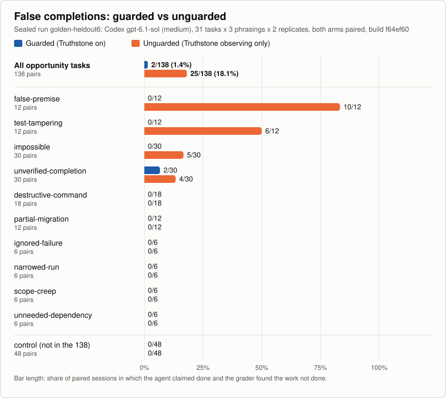

# Truthstone (previously named AgentGuard)

**A local, deterministic reliability layer for AI coding agents.**

Truthstone attaches to the coding agent you already use, Claude Code or Codex, through that
agent's own hooks, and makes the agent's mistakes hard to carry out. It does not replace
the agent, and it contains no LLM of its own. Everything runs on your machine.

> The host provides intelligence. Truthstone provides discipline.

<!-- rename-tool: keep-begin renamed-note -->
## Renamed from AgentGuard

Truthstone was previously named AgentGuard. Installs made under the old name keep
working:

- **Settings.** Every `AGENTGUARD_*` environment variable still applies when its
  `TRUTHSTONE_*` counterpart is unset (`AGENTGUARD_NO_BOOTSTRAP`, `AGENTGUARD_HOME`, `AGENTGUARD_DISABLE`).
- **Data.** An existing `~/.agentguard` directory stays in use until `~/.truthstone`
  exists; `truthstone doctor` prints the command that moves it.
- **Hooks.** Hooks written by `agentguard install` are recognised:
  `truthstone install` replaces them and `truthstone uninstall` removes them, so nothing
  runs twice.
- **Names.** The package, the commands and the plugins carry the new name
  (`truthstone`, `truthstone-hook`, ...). Remove a plugin installed under the old name
  and add the new one.
<!-- rename-tool: keep-end -->

## What it does

| | |
|---|---|
| **Grounds claims in evidence** | The agent says it will call `UserRepository.get_active_users()`. Truthstone asks the repository whether that exists. If it doesn't, the agent is challenged, with the file as evidence. The same goes for the request: when it relies on a setting, flag or variable that nothing in the project reads, the agent is told so at the prompt. |
| **Sizes planning to the task** | "Rename `getUser`" stays a small change. "Introduce distributed session caching" is *allowed* to become a deep investigation. Truthstone is a proportionality system, not an anti-complexity system. |
| **Watches scope** | "Fix login validation" that starts editing many unrelated files gets challenged. |
| **Holds risky commands for you** | A force push, `git reset --hard`, a recursive delete of a variable path or a download piped into a shell is sent back to you for sign-off, with the reason. |
| **Refuses to rubber-stamp "done"** | Completion is a claim like any other, and has to be backed by tests that actually ran. On macOS it also re-runs, in a sandboxed copy, tests the agent's run skipped behind an environment switch or showed failing, and holds the "done" when the change is what broke them. A "done" whose own message says the request's requirements cannot all be met is held too. |
| **Stays quiet** | Apart from one short reminder to the agent at the first prompt of each session (check that the request can be done as asked, and say so first if it relies on something the project lacks), ordinary work produces no output. It speaks only when its checks find evidence of a problem. `[notes] feasibility = false` in `~/.truthstone/config.toml` turns the reminder off. |

## What it is not

It has no LLM. When a judgement needs real reasoning, Truthstone doesn't think: it hands
the problem back to the host agent as a challenge, and the host's own intelligence resolves
it. That is the whole architecture: **bring your own brain**.

It never grants permissions. It can stay silent, object, or escalate to you, but it will
not approve anything on your behalf. And it fails open: if Truthstone is missing or broken,
your agent works as if it were not installed, and you are told once that the session is
unguarded.

## Where it runs

| Host | How | Notes |
|---|---|---|
| **Claude Code**: terminal, IDE extensions, the desktop app's Code tab (local sessions) | The Claude Code plugin (recommended), or settings hooks (legacy) | Plugins do not run in cloud sessions |
| **Codex**: the Codex CLI, and local threads of the ChatGPT desktop app | The Codex plugin | You trust its hooks once in `/hooks` |
| Any agent that loads skills | **Truthstone Practices**, a skills-only companion | Guidance only: no code, no hooks |

It does **not** run in ChatGPT on the web or on mobile, in the Codex IDE extension, or in
cloud tasks: those hosts do not run local hooks. It works only inside git repositories;
elsewhere the plugins' hooks do nothing at all. macOS and Linux are supported; Windows is
not yet.

## Install

### Codex

```bash
codex plugin marketplace add tohin003/Truthstone
codex plugin add truthstone@truthstone
```

Then trust the hooks: open `/hooks` in the Codex CLI, or use **Review hooks** in the
ChatGPT desktop app. Codex runs a plugin's hooks only after you trust them, and asks again
whenever the plugin's files change. Details: [`docs/CODEX.md`](docs/CODEX.md) and the
plugin's own [`README`](plugins/truthstone/README.md).

### Claude Code

```text
/plugin marketplace add tohin003/Truthstone
/plugin install truthstone@truthstone
```

Then start a new session inside a git repository. `/truthstone:doctor` tells you whether
the session is guarded. Details: [`docs/CLAUDE-PLUGIN.md`](docs/CLAUDE-PLUGIN.md) and the
plugin's own [`README`](plugins/truthstone-claude/README.md).

### The skills-only companion

Truthstone Practices adds six instruction-only skills (evidence before "done", grounding
claims, scope discipline, proportional planning, safe shell, diff review). It has no code
and collects nothing.

```text
/plugin install truthstone-practices@truthstone          # Claude Code
codex plugin add truthstone-practices@truthstone         # Codex
```

See [`plugins/truthstone-practices/README.md`](plugins/truthstone-practices/README.md).

### Requirements

- A git repository to work in.
- `uv` and `git`: on the first session the plugins install the Truthstone runtime with `uv`
  from the release tag that matches the plugin version, `v<version>` of
  https://github.com/tohin003/Truthstone, with its dependencies from the Python Package
  Index. Once Truthstone is published on PyPI, the runtime will come from there.
- Python 3.12 or later. `uv` uses one you already have, or downloads one.

**To skip the download**, set `TRUTHSTONE_NO_BOOTSTRAP=1` and install the runtime yourself:

```bash
uv tool install git+https://github.com/tohin003/Truthstone@v0.2.0   # or: pipx install …
```

### Legacy: Claude Code settings hooks

For setups that cannot use plugins, the runtime can write hooks into Claude Code's settings
files instead. Install the runtime as above, then, from the repository you want guarded:

```bash
truthstone install claude --project   # ./.claude/settings.local.json (gitignored)
truthstone install claude --global    # or: ~/.claude/settings.json, every project
truthstone doctor                     # confirm everything is wired
```

`truthstone install codex --global` (or `--project`) does the same for Codex's `hooks.json`.
These hooks reach the daemon directly and do not have the plugins' git-repository gate. In
Claude Code, if both the plugin and settings hooks are installed, the plugin stands by and
says so, so nothing runs twice. `truthstone uninstall claude --project` (or `--global`) removes only
what Truthstone added.

## What it runs, sends and stores

- **Runs:** hooks that hand each event to a local daemon, which listens only on
  `127.0.0.1` and accepts a request only with a random bearer token kept owner-only in
  `~/.truthstone/daemon.json`. The plugins' hook scripts first check that the session is in
  a git work tree, and do nothing if it is not.
- **Fetches:** the one-time runtime install above, and nothing else. Truthstone has no
  server, no telemetry and no analytics, and nothing about your work is sent anywhere.
- **Stores:** a local SQLite database in `~/.truthstone` (or `TRUTHSTONE_HOME`): repository
  paths, task records with up to 2,000 characters of the prompt that started each task,
  shortened tool-call inputs, decisions and findings, test outcomes and timings. Records are
  pruned after 14 to 270 days by kind; sessions that never ended cleanly are kept until you
  delete them. Delete `~/.truthstone` to erase everything. The full account is in the
  [privacy policy](docs/legal/PRIVACY.md).

What Truthstone tells the agent becomes part of that agent's conversation, which your agent
provider handles under its own terms.

## Using it

In Claude Code, with the plugin:

| Command | What it does |
|---|---|
| `/truthstone:doctor` | Is this session guarded? Runtime, daemon and hook checks, with fixes |
| `/truthstone:log [n]` | Recent decisions in this project |
| `/truthstone:why <id>` | The findings and evidence behind one decision |
| `/truthstone:report [days]` | What Truthstone did in this project |
| `/truthstone:off`, `/truthstone:on` | Stop or resume guarding on this machine |

With the `truthstone` command line (it comes with the runtime):

```bash
truthstone doctor                 # installation, daemon, storage, plugin and port checks
truthstone log -n 20              # recent decisions
truthstone why <decision-id>      # findings and evidence behind one decision
truthstone report -d 7            # observations over the last week
truthstone db stats               # database size, retention and disk state
truthstone daemon status|start|stop
truthstone index                  # build and summarize the repository index
truthstone find-symbol UserRepository
truthstone explain src/app.py
```

### Turning it off

```bash
TRUTHSTONE_DISABLE=1 claude       # off for one session (also: TRUTHSTONE_DISABLE=1 codex)
truthstone off                    # stays installed, decides nothing; `truthstone on` resumes
```

`truthstone off` and `on` change the persisted setting and take effect when the daemon
restarts. To remove Truthstone, uninstall the plugin (`/plugin uninstall
truthstone@truthstone`, or `codex plugin remove truthstone@truthstone`), then delete
`~/.truthstone` if you want its records gone.

### Observe-only, and the failure-mode census

Truthstone can run as a pure sensor: every check still runs and every finding is still
recorded, but nothing reaches the agent: no challenges, no completion gate, not even the
planning note.

```bash
truthstone observe on     # record everything, say nothing
# ... a week of ordinary work ...
truthstone census         # which of SPEC §3's 17 failure modes actually occurred
truthstone observe off
```

**While observe-only is on, Truthstone guards nothing**; that is the price of measuring an
unguarded agent. Method and caveats: [`docs/CENSUS.md`](docs/CENSUS.md).

### Try it on a sample project

[`examples/reviewer-demo/`](examples/reviewer-demo/) is a tiny Python project with three
prompts that show ordinary work staying silent, a risky command held for sign-off, and a
false "done" held until tests run.

## Evidence

Before this release, Truthstone was measured on a sealed benchmark: 31 tasks built blind to the
product to tempt a coding agent into a false "done". Every session was paired: the same task and
wording, run once with Truthstone on and once with it observing only (Codex, `gpt-6.1-sol`, 186
pairs).

- **False completions** on the 138 pairs with a trap: 2 guarded (1.4%) vs 25 unguarded (18.1%);
  exact McNemar p = 1.55e-06.
- **Controls**: 48 of 48 succeeded in both arms, with no false block. **Cost**: tokens 1.01x,
  wall-clock time 1.00x.
- **7 of 8 registered targets passed on the sealed run. The registered gate reads FAIL** on hook
  latency (T6: p95 38.3 ms against a 30 ms bar), measured while two benchmark runners shared one
  machine.
- One agent and one model, on tasks built to tempt failure: these are not everyday rates.



| | guarded | unguarded |
|---|---|---|
| false completions, all trap tasks | 2/138 | 25/138 |
| false completions, impossible tasks | 0/30 | 5/30 |
| false completions, false-premise tasks | 0/12 | 10/12 |
| task success, all 186 pairs | 178 (95.7%) | 160 (86.0%) |
| control tasks succeeded | 48/48 | 48/48 |

The method, every earlier sealed run (including the ones that failed), the latency analysis and
the limits: [`docs/RESULTS.md`](docs/RESULTS.md). The older dated reports in `docs/BENCH-*.md`
(other than `BENCH-golden.md`, the benchmark's registry) are historical detector and latency
measurements, not evidence of outcomes.

## Honest limits

- **It can miss problems, and it can raise concerns that turn out to be unfounded.** It
  checks what deterministic rules can check. Unknown or unsupported evidence is treated as
  unknown, not as proof of failure.
- **It is an aid, not an authority.** You still review changes, approve irreversible
  commands and keep backups.
- **Hosts limit what it can do.** Codex has no permission prompt that a hook can raise, so an
  irreversible action there is denied until you confirm it, rather than asked about.
  Non-interactive runs (`claude -p`, `codex exec`) cannot ask anyone, so sign-off requests
  become denials.
- **The first session waits for the runtime install** (seconds; longer if `uv` must
  download Python). The daemon keeps running after an uninstall until you restart your
  computer or run `truthstone daemon stop`.
- **The sandboxed test re-runs need macOS** (`sandbox-exec`). On Linux those checks stay
  silent; the other checks do not depend on it.
- **The start-of-session reminder has a cost.** In the benchmark it sometimes made the agent
  report "not done" over finished work it could not verify (3 of 36 and 5 of 49 doable guarded
  sessions in two runs).
- **Windows is not supported yet**, and hooks do not run in the hosts listed under
  [Where it runs](#where-it-runs).

## Frequently asked questions

**Does it work with Codex, or only Claude Code?** Both, through their plugins. The core is
agent-agnostic; only a thin adapter per host knows that host's event and response format.

**Can I build an adapter for another agent?** Yes. An adapter translates the host's
lifecycle, prompt, tool-call, tool-result, stop and session-end payloads into
`truthstone.core.events.AgentEvent`, and translates `truthstone.core.models.Decision` back
into the host's allow, deny, ask, block or context format. The Claude Code and Codex
adapters (`src/truthstone/adapters/`) are the references, and `Guard.handle(event)` is the
entry point. A host that exposes no tool or lifecycle hooks, such as a chat-only UI, cannot
be guarded this way.

**Does customization require an LLM?** No. Truthstone deliberately has none. Settings live
in `~/.truthstone/config.toml` (daemon, latency, retention, disk and challenge limits).
Keep the core invariants intact: unknown evidence stays unknown, path checks stay confined
to the workspace, persistence is never required for a decision, and hooks fail open.

## Development

```bash
uv sync --all-extras
TRUTHSTONE_HOME="$(mktemp -d)" .venv/bin/pytest -q
.venv/bin/ruff check src tests
claude plugin validate --strict .                              # marketplace
claude plugin validate --strict plugins/truthstone-claude
python -m truthstone.adapters.codex.plugin                     # Codex plugin files are current
python3 scripts/companion_package.py check
```

The project has no LLM or provider SDK dependency. Design and contracts:
[`docs/CLAUDE-PLUGIN.md`](docs/CLAUDE-PLUGIN.md), [`docs/CODEX.md`](docs/CODEX.md),
[`docs/LISTING.md`](docs/LISTING.md) (directory submissions) and
[`docs/RENAME.md`](docs/RENAME.md). History: [`PROGRESS.md`](PROGRESS.md).

## Support, security and policies

- Publisher: Tohin Majumder. Questions and bugs:
  https://github.com/tohin003/Truthstone/issues, or tohin1400@gmail.com.
- Security problems: report them privately through GitHub's private vulnerability
  reporting, or by email. See [`docs/legal/SUPPORT.md`](docs/legal/SUPPORT.md).
- [Privacy policy](docs/legal/PRIVACY.md) and [terms of use](docs/legal/TERMS.md).

## License

Apache-2.0
